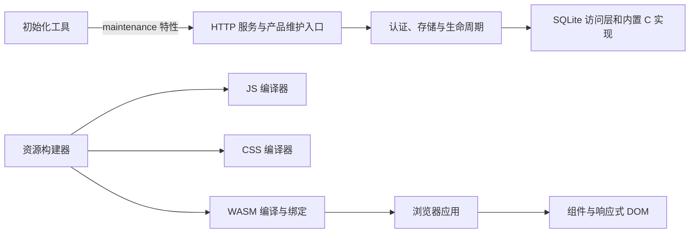

# 架构

blog 的服务端、浏览器业务和构建工具使用 Rust。原生服务与构建宿主支持 `x86_64-unknown-linux-gnu`（AMD64 Linux、64 位指针、GNU/glibc ABI），浏览器界面编译为 `wasm32-unknown-unknown`。项目包的构建脚本直接检查 HOST/TARGET。

## 源码职责

产品、基础实现与工具源码集中在 `src/`，测试实现与专用输入集中在 `test/`。全部 Rust 包共用根 Cargo workspace 和唯一的 Cargo.lock，依赖通过本仓库的路径解析。基础实现按用途位于 `src/foundation/<layer>/<purpose>`。

| 目录 | 职责 |
| --- | --- |
| `src/server` | HTTP 路由、公开内容、管理员 API 与服务启动 |
| `src/application` | 配置、认证、会话、SQLite、私有状态、安装合同与资源响应 |
| `src/browser` | 公开页面、管理后台、评论、编辑器、请求、状态与 Markdown |
| `src/interface` | 组件、主题、浏览器适配与应用挂载 |
| `src/interface/dom` | 响应式 DOM、类型化视图、属性与生命周期 |
| `src/interface/macros` | 组件与属性的语法生成 |
| `src/foundation` | 本地协议、存储、异步、编码、密码、系统接口与编译器 |
| `src/tools/assets` | JS/CSS 编译、WASM 绑定、资源校验与开发预览 |
| `src/tools/setup` | 离线初始化、实例检查与管理员凭据恢复 |
| `test/browser-domain` | 浏览器数据合同及 Markdown 的宿主测试 |
| `src/web` | 加载入口、样式、字体与浏览器构建配置 |
| `src/tools` | 资源、初始化、打包和来源校验工具 |
| `src/operations` | 发行包构建与暂存入口 |
| `test` | Rust 单元与集成测试、浏览器场景、验证工具和测试数据 |

Rust 单元测试通过条件模块声明连接到 `test/<组件>/unit/`，保持对原模块私有实现的访问；集成测试由 manifest 显式指定 `test/<组件>/integration/` 中的入口。浏览器场景位于 `test/browser/`，不随生产资源发布。测试入口和运行方法见[测试目录](../test/README.md)。

精确的包、入口与依赖关系见[依赖文档](dependencies/README.md)和[生成的用途关系](RUST_SOURCE_ARCHITECTURE.md)。

## 输入与错误边界

代码遵循根目录的 [Rust 编码规范](../AGENTS.md)。HTTP、文件、环境变量、浏览器存储和外部进程是信任边界；内部函数接收已解析的类型，依赖私有字段和调用约定。缺失的内部必需数据属于程序错误，使用明确的不变量断言。

| 边界 | 验证与内部保证 |
| --- | --- |
| 密码输入 | `admin_auth::Password::new` 验证策略，哈希作业接收 `Password`；熵源与哈希运算失败保留错误来源 |
| 实例 ROOT | `server_layout::Layout::new` 验证路径，私有根字段保证派生目录；打开文件时继续验证描述符、权限和身份 |
| HTTP 请求体 | 入口限制格式、字节数、读取时长和并发数；信号量许可随读取结束或取消释放 |
| 浏览器 HTTP 响应 | 合同与模型在解码时验证；栏目来源、错误码和请求 ID 用类型表达，未知合法远端错误码保留原值 |
| 浏览器待确认提交 | 读取存储时校验结构；存储清理失败会阻止覆盖原请求，恢复流程保持幂等 |
| 资源与构建输入 | 清单验证后成为 `VerifiedManifest`，内部读取使用已验证路径；构建模式由枚举限定，子进程保留输出、截止时间和清理限制 |

服务端、认证、文件和子进程错误使用具体错误类型保留来源。HTTP 响应或可执行程序入口负责记录和脱敏，客户端只接收稳定的错误合同。资源构建的高层编排仍接收编译器与绑定工具的动态错误；业务模块不把这些接口作为通用错误容器。

## 服务端

`src/server` 实现内容业务和 HTTP API，`src/application` 提供认证、会话、SQLite、文件和生命周期能力。管理员密码使用 Argon2id；会话、CSRF、文章权限和匿名提交幂等由服务端执行。当前业务与数据约束见[行为合同](contracts.md)。

`src/server/src/content/mod.rs` 组合公开和管理员路由；文章、分类、评论、站点设置等私有功能模块各自拥有同一业务的读取、写入与校验。站点媒体 URL 的规范化属于站点设置模块。业务处理直接使用 application 的事务、认证和文件能力，路由组合层不另建一套服务或存储抽象。

`src/server/src/media.rs` 保留上传、删除的完整协调流程，私有的 `formats`、`references` 和 `storage` 模块分别负责格式与限额、站内引用检查、文件发布和删除恢复。格式描述统一决定字节识别、文件扩展名及资源类型。删除先在 SQLite 写事务中检查引用，再暂存文件、提交数据库并清理；文件系统与 SQLite 通过删除暂存标记和启动恢复协调。持久化操作由应用工作域接管，客户端断开不会中途取消已接纳的提交。

SQLite 随源码固定编译。访问层提供 Tokio 连接池、事务、预处理语句、实际类型编解码和 `FromRow`。行可跨线程移动，其解码状态不允许并发共享。配置、数据库、媒体、日志和运行快照统一位于显式指定的 ROOT；安装与运行布局见[部署说明](../deploy/linux-x86_64/README.md)。

初始化工具通过服务端的 `maintenance` 特性调用产品维护入口，复用运行服务的 schema、配置与安装合同。`config_definition.rs` 拥有产品默认 ROOT、状态目录和数据库文件名；运行配置与导出的安装计划使用同一组定义。application 保留可复用的合同与校验能力，产品默认值由服务端决定。

Linux 系统层使用固定 ABI、原始系统调用、epoll/eventfd 和系统熵源。浏览器随机数由 Web Crypto 提供。宿主与浏览器目标分别构建，过程宏和构建脚本在 Linux 宿主执行。

## 浏览器

浏览器应用采用 CSR。Rust 负责路由、页面、业务状态、请求、日期、Markdown 和交互；DOM 层负责构建、更新、挂载与拆卸，提供响应式状态、动态列表、context、Portal 和错误边界。

`public/mod.rs` 选择公开页面，`admin.rs` 定义后台导航并分派页面；各自的私有功能模块拥有页面状态与视图。`common` 按请求、写操作、分页、导航、表单和灯箱等职责提供共享原语。读取状态管理加载、错误、上次结果和刷新；写操作统一管理忙碌状态、错误与上传。请求随页面所有者释放而取消，并在应用响应前检查取消状态，防止离开页面后的回调写入失效状态。

`models.rs` 定义页面使用的类型化读取模型，`contracts.rs` 在请求边界检查响应及分页身份。站点和媒体配置的必需可空字段由类型解码约束：显式 `null` 表示未配置，缺失字段会失败。服务端拥有写入与持久化合同，浏览器模型只保留界面使用的投影。

原生弹窗由 `src/interface/src/modal.rs` 统一管理显示、键盘焦点、Escape 关闭和卸载后的焦点恢复。产品页面保留内容、样式和关闭状态，共享层负责浏览器模态语义。

管理后台复用一组布局与控件几何角色；公开页面保留独立布局与尺寸，只共享 Rust 实现的 G4 连续圆角。尺寸、来源与验证入口见[界面样式](interface-design.md)。

`src/web/src/main.js` 导入样式、加载绑定并启动 WASM；`src/web/runtime/startup.js` 提供 WASM 或字体准备失败时的错误面板及重载按钮。`src/web/pkg` 中的 JavaScript 由绑定工具生成，`.mjs` 脚本用于测试与工具检查。

## 资源构建

`blog-assets` 直接调用两个独立的 JS/CSS 编译器，并在进程中生成 WASM 浏览器绑定。生产资源构建使用本地 Rust 源码，输出 WASM、JavaScript、CSS、字体、许可、gzip 与资源收据。

每次构建按内容校验源码、构建器和资源输入。同一构建快照复用解析和文件摘要，构建前后摘要必须一致。资源目录与前端收据一起提交；收据发布失败时恢复原资源。WASM 的 gzip/identity 允许状态由共享 HTTP 层解析，已有资源无可接受表示时返回空 `406`。开发代理复用 HTTP/1 连接池，按请求和响应流转发，包含背压、取消及完整 deadline。

同一产品的资源和联合原生构建共用持有到发布、校验及导出结束的写入锁，回滚只操作当前所有者的产物。外部命令以固定输出预算、截止时间和进程组清理约束运行；开发监听器保留构建期间的后续输入变化。

构建脚本与运行时清单校验共享 `source_inputs.rs` 的路径、文件数量、单文件大小和读取稳定性规则。`layout.rs` 集中声明本产品的源码目录；前端输入固定为 `src/web`，根 `blog-assets.json` 选择静态资源输出与原生构建参数。基础实现、依赖资料、测试与许可输入仍纳入源码身份，构建输出按明确路径排除。

构建命令与资源目录见[开发说明](development.md)，基础库的当前用途与支持面见[依赖文档](dependencies/README.md)。

## 源码和发行身份

内部基础包通常省略 manifest 版本，由 Cargo 记为 `0.0.0`；产品发行版本单独管理。原始发布名、版本、完整归档、逐文件摘要和许可证存放于 `compliance/`，本地实现与原始身份分别核验。来源字段、离线边界和校验命令见[源码组织与校验](source-layout.md)。
