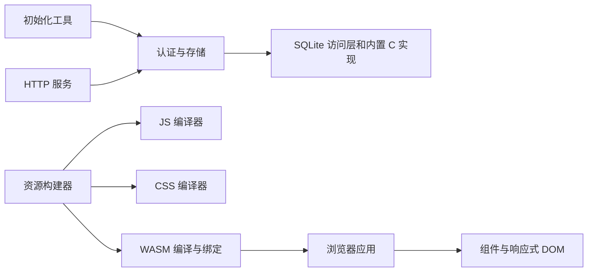

# 架构

blog 的服务端、浏览器业务和构建工具使用 Rust。原生服务与构建宿主支持 `x86_64-unknown-linux-gnu`（AMD64 Linux、64 位指针、GNU/glibc ABI），浏览器界面编译为 `wasm32-unknown-unknown`。项目包的构建脚本直接检查 HOST/TARGET。

## 源码职责

全部 Rust 包共用根 Cargo workspace 和唯一的 Cargo.lock，依赖通过本仓库的路径解析。基础实现按用途位于 `src/foundation/<layer>/<purpose>`。

| 目录 | 职责 |
| --- | --- |
| `src/server` | HTTP 路由、公开内容、管理员 API 与服务启动 |
| `src/application` | 配置、认证、会话、SQLite、私有状态、安装合同与资源响应 |
| `src/browser` | 公开页面、管理后台、评论、编辑器、请求、状态与 Markdown |
| `src/interface` | 组件、主题、浏览器适配与应用挂载 |
| `src/interface/dom` | 响应式 DOM、类型化视图、属性与生命周期 |
| `src/interface/macros` | 组件与属性的语法生成 |
| `src/foundation` | 本地协议、存储、异步、编码、密码、系统接口与编译器 |
| `tools/assets` | JS/CSS 编译、WASM 绑定、资源校验与开发预览 |
| `tools/setup` | 离线初始化、实例检查与管理员凭据恢复 |
| `test/browser-domain` | 浏览器数据合同及 Markdown 的宿主测试 |
| `web` | 加载入口、样式、字体与浏览器测试 |

精确的包、入口与依赖关系见[依赖文档](dependencies/README.md)和[生成的用途关系](RUST_SOURCE_ARCHITECTURE.md)。

## 服务端

`src/server` 实现内容业务和 HTTP API，`src/application` 提供认证、会话、SQLite、文件和生命周期能力。管理员密码使用 Argon2id；会话、CSRF、文章权限和匿名提交幂等由服务端执行。当前业务与数据约束见[行为合同](contracts.md)。

SQLite 随源码固定编译。访问层提供 Tokio 连接池、事务、预处理语句、实际类型编解码和 `FromRow`。行可跨线程移动，其解码状态不允许并发共享。配置、数据库、媒体、日志和运行快照统一位于显式指定的 ROOT；安装与运行布局见[部署说明](../deploy/linux-x86_64/README.md)。

Linux 系统层使用固定 ABI、原始系统调用、epoll/eventfd 和系统熵源。浏览器随机数由 Web Crypto 提供。宿主与浏览器目标分别构建，过程宏和构建脚本在 Linux 宿主执行。

## 浏览器

浏览器应用采用 CSR。Rust 负责路由、页面、业务状态、请求、日期、Markdown 和交互；DOM 层负责构建、更新、挂载与拆卸，提供响应式状态、动态列表、context、Portal 和错误边界。

`web/src/main.js` 导入样式、加载绑定并启动 WASM；`web/runtime/startup.js` 提供 WASM 或字体准备失败时的错误面板及重载按钮。`web/pkg` 中的 JavaScript 由绑定工具生成，`.mjs` 脚本用于测试与工具检查。

## 资源构建

`blog-assets` 直接调用两个独立的 JS/CSS 编译器，并在进程中生成 WASM 浏览器绑定。生产资源构建使用本地 Rust 源码，输出 WASM、JavaScript、CSS、字体、许可、gzip 与资源收据。

每次构建按内容校验源码、构建器和资源输入。同一构建快照复用解析和文件摘要，构建前后摘要必须一致。资源目录与前端收据一起提交；收据发布失败时恢复原资源。WASM 的 gzip/identity 允许状态由共享 HTTP 层解析，已有资源无可接受表示时返回空 `406`。开发代理复用 HTTP/1 连接池，按请求和响应流转发，包含背压、取消及完整 deadline。

构建命令与资源目录见[开发说明](development.md)，基础库的当前用途与支持面见[依赖文档](dependencies/README.md)。

## 源码和发行身份

内部基础包通常省略 manifest 版本，由 Cargo 记为 `0.0.0`；产品发行版本单独管理。原始发布名、版本、完整归档、逐文件摘要和许可证存放于 `compliance/`，本地实现与原始身份分别核验。来源字段、离线边界和校验命令见[源码组织与校验](source-layout.md)。
