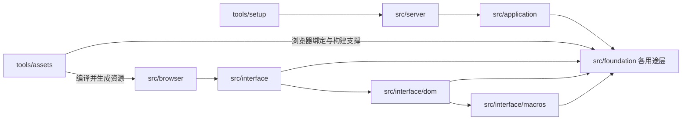

# 用途架构与定制

当前源码按博客需要的职责维护，不以继续跟随上游发布为目标。协议、密码、存储和构建等实现可以在本项目中重写、合并或拆分；每次变化都要保留来源、说明原因并验证实际用途。将目录改名只是组织变化，下面分别记录结构变化和已经修改的实现。

## 当前布局

所有 Rust 包共用根虚拟 workspace 与唯一的 Cargo.lock。当前受管源码包含 243 个包：234 个用途基础包和 9 个项目包；根锁完整图包含 242 包。包数只作完整清点，不作为优化完成条件或构建门禁；正常依赖、构建脚本、派生宏及测试均计入。唯一未被当前图选中的保留源码是 `cli/terminal-probe`，它仍由配置解析器的 optional 终端判断能力引用，仍保留在完整源码计数中。

各职责的分析、合并边界和消费者约束见[依赖分析与深度定制](dependency-customization.md)。

| 位置 | 包名 | 职责 |
| --- | --- | --- |
| `src/server` | `blog` | HTTP 服务、公开内容、后台 API 与产品启动 |
| `src/application` | `blog-application` | 认证、SQLite、私有状态、安装合同与资源响应 |
| `src/browser` | `blog-browser` | 博客页面与管理后台的浏览器 CSR 应用 |
| `src/interface` | `blog-interface` | 本项目组件、主题、浏览器适配与应用挂载 |
| `src/interface/dom` | `blog-dom` | 响应式 DOM、组件属性与生命周期 |
| `src/interface/macros` | `blog-component-macros` | 组件与属性的语法生成 |
| `tools/assets` | `blog-assets` | 前端编译、浏览器绑定、资源收据、开发预览与服务端候选构建 |
| `tools/setup` | `blog-setup` | 离线初始化、检查与管理员恢复 |
| `test/browser-domain` | `blog-browser-domain-tests` | 数据合同、Markdown 等浏览器域逻辑的宿主测试 |
| `src/foundation/<layer>/<purpose>` | 按实际用途命名的本地包 | 网络、存储、异步运行、密码、编码、格式、WASM 与编译支撑 |

`tools/assets` 直接调用内部浏览器模块生成 WASM 绑定，不再有独立 bindings 包或需要安装的绑定 CLI。根 `blog-assets.json` 选择前端与服务端入口；`web/styles` 保留 CSS 和字体，`web` 中的 Node 工具只负责独立浏览器测试。



图说明主要职责关系，完整声明图与入口闭包见[生成的用途架构](RUST_SOURCE_ARCHITECTURE.md)。该图不表示每条边都在同一目标执行，也不代替实际链接、浏览器或业务验收。

## 内部版本与来源

当前 Cargo 依赖均指向仓库内路径，不以原始上游包版本范围约束维护代码。维护包通常省略 manifest 的 version，由 Cargo 记为内部 0.0.0。`blog` 和 `blog-setup` 的发行版本单独管理，当前为 1.0.1；Rust 1.99.0 与 WASM 目标仍是明确的构建环境要求。

原始包名、发布版本、完整 `.crate`、逐文件原始摘要和许可材料保存在 `compliance/` 及[来源文档](THIRD_PARTY_RUST_SOURCES.md)。当前源码摘要单独登记，不能用维护后的文件冒充原始发布字节。归档和来源记录保持原样；来源中的旧目录只说明历史导入位置。

显式迁移日志以原有 407 包为基线，记录当前用途布局、7 项兼容版本合并以及宏和工具整合；46 个完全不再保留实现的原始来源已明确退役。组件宏仍保留的历史 literal helper 通过显式恢复事件重新计入活动来源和审计，未恢复其独立 Cargo 包。当前 351 个活动原始身份、243 个维护包与 397 份归档采用不同口径，不能互相代替。退役保留原始档案及法律材料。

## 已做的实现定制

| 改动 | 当前实现与支持面 | 可确认的变化 |
| --- | --- | --- |
| SQLite 行映射宏 | `storage/record-derive` 只保留本项目使用的 `FromRow` 与属性语法；不在宏中连接数据库或执行编译期查询 | 按本次 host 闭包计数，从 191 个包减为 6 个；不是编译时间实测 |
| 浏览器 CSR 组件 | 保留类型化组件、属性构建、响应式 DOM 与浏览器挂载；删除 RSX 解析、服务端渲染、水合、岛屿及拆分加载等支持面 | CSR 裁剪移除 10 个不再需要的包；不能推算 WASM 体积或交互时延变化 |
| 嵌入资源查找 | 严格校验资源表按路径排序，HTTP 响应通过二分查找定位精确资源 | 以 33 项资源表为例，最坏路径比较次数由线性 33 次降至最多 7 次；未测量请求延迟 |
| 宿主资产编译器 | 35 个真实 JS/CSS 编译阶段及专用辅助实现进入一个 `assets/compiler` 包，保留 AST、解析、语义校验、模块链接与压缩 | 实际减少 34 个包；没有据此推算构建时间或输出体积 |
| CSR 内核与属性宏 | 20 组实际保留的运行实现进入 DOM 内核，类型化属性与 token 构造进入项目组件编译器；移除未用的异步资源/transition 支持 | 保留实际组件与浏览器消费者，原始来源分别登记到当前所有者 |
| 浏览器绑定生成 | 绑定生成整合进 `blog-assets` 的进程内模块，直接输出浏览器初始化及 JS/WASM | 移除独立 CLI 编译、定位和调用环节；未测量整体构建耗时 |

这些修改针对当前 Linux x86_64 GNU 服务端、原生构建工具与浏览器 WASM。它们不承诺原始库的其他平台、功能组合或完整公开 API；未来增加用途时，应先恢复或实现所需能力并补验证。

## 维护与验证

日常修改先审查代码和对应测试，再通过来源管理器显式登记当前摘要。包身份或所有者变化还必须追加迁移事件；历史原始来源、迁移日志和补丁日志都不能覆盖改写。历史补丁路径可继续指向已经搬走的旧包，由迁移身份历史证明其原所有者。

```sh
python3 tools/rust-sources/manage.py refresh
python3 tools/rust-sources/manage.py verify --metadata
python3 tools/check-independence.py
```

完整字段规则见[源码维护](RUST_SOURCE_MAINTENANCE.md)，原生与 WASM 命令见[开发验证](development.md)。ZXS 精确历史 Git 输入、逐文件摘要及 Blog 退役前维护树快照保存在 `compliance/provenance/integrations/`。本地维护快照与原始发布归档分开；其时间点及已知边界在收据中明确说明。

安全审计从当前包映射恢复所有活动原始发布身份，合并与改名不能让旧来源漏扫；本地定制也不能自动视为已修复上游 advisory。

空 Cargo home 的 metadata 证明受检 Rust 图不从外部注册表或 Git 解析源码。编译、原生测试、真实浏览器、安装维护、漏洞审计与正式发布分别提供证据；宏闭包缩小和比较次数降低不等于已测得性能提升。
