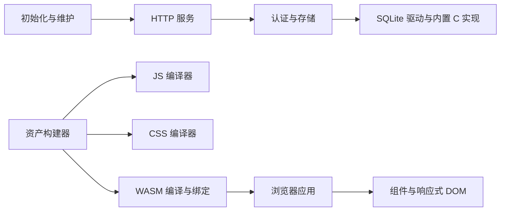

# 用途架构与定制

本项目按博客的实际消费者维护全部 Rust 实现。服务端与构建宿主只支持 `x86_64-unknown-linux-gnu`：AMD64 Linux、64 位指针、GNU/glibc ABI。浏览器界面输出 `wasm32-unknown-unknown`，其域逻辑和 DOM 测试也可在支持的 Linux 宿主运行。

## 入口与所有权

全部包使用根 Cargo workspace 和唯一根 Cargo.lock；依赖指向仓库内路径。第三方实现位于 `src/foundation/<layer>/<purpose>`，项目包位于下表目录。当前包数、实际声明边及来源映射由[用途关系](RUST_SOURCE_ARCHITECTURE.md)和[源码清单](THIRD_PARTY_RUST_SOURCES.md)生成。

| 位置 | 职责 |
| --- | --- |
| `src/server` | HTTP 路由、公开内容、后台 API 与产品启动 |
| `src/application` | 认证、会话、SQLite、私有状态、安装合同与资源响应 |
| `src/browser` | 公开页面与管理后台的浏览器 CSR 应用 |
| `src/interface` | 组件、主题、浏览器适配与应用挂载 |
| `src/interface/dom` | 响应式 DOM、类型化视图、属性与生命周期 |
| `src/interface/macros` | 组件与属性的语法生成 |
| `tools/assets` | JS/CSS 编译、WASM 绑定、资源收据、开发预览与候选构建 |
| `tools/setup` | 离线初始化、检查与管理员恢复 |
| `test/browser-domain` | 数据合同、Markdown 等浏览器域逻辑的宿主测试 |



图只表达主要职责，完整 Cargo 依赖及目标归属以生成清单为准。

## 业务逻辑使用 Rust

业务规则、认证、存储、数据校验和 HTTP 合同由 `src/server` 与 `src/application` 实现。浏览器的路由、公开页面、后台管理、评论、编辑器、请求、状态、日期和 Markdown 处理都在 `src/browser` 的 Rust 模块中，通过 WASM 调用浏览器 API。新增业务继续放入这些 Rust 层；跨前后端共享规则应提取为能在原生和 WASM 编译的 Rust 模块。

手写生产 JavaScript 只有两个入口：`web/src/main.js` 导入样式、加载生成绑定并启动 WASM；`web/runtime/startup.js` 在 WASM 下载、实例化或字体准备失败时显示可访问的错误面板和重载按钮。这条失败路径必须独立于尚未启动的 WASM。`web/pkg` 是生成的绑定产物，其余 `.mjs` 用于测试与工具链检查。业务状态和请求规则不进入这些加载代码。

## 产品专用边界

- **系统接口**：Linux ABI、原始系统调用、epoll/eventfd 事件轮询和 Linux 熵源保留实际后端。浏览器随机数使用 Web Crypto。项目入口的共享 build 脚本检查 HOST/TARGET，拒绝 ARM、GNU x32、musl 等未支持配置。
- **SQLite**：原生包固定编译仓库 SQLite。访问层保留 Tokio 连接池、事务、预处理语句、实际类型编解码和 `FromRow`；通用多数据库配置、网络协议、外部库发现与 SQLCipher 不属于产品实现。行可以转移到另一线程，解码状态不能并发共享。
- **浏览器界面**：视图协议只承担 CSR 的构建、更新、挂载与拆卸，保留类型化组件、响应式状态、动态列表、context、Portal 与错误边界。服务端 HTML 流、水合、岛屿及模板生成接口已从运行协议移除。
- **HTTP**：服务端与开发代理复用现有 HTTP 类型和传输实现。开发代理使用 HTTP/1 客户端池，转发实际请求流与响应流；独立通用客户端、代理发现、自动重试等未消费能力已删除。
- **资产编译**：JS 与 CSS 编译器是两个独立包，资产工具直接消费两者。每个包内保留真实解析、语义和压缩阶段；类型派生器生成路径指向实际类型提供者。拆分依据是独立依赖边和构建实测。
- **构建输入**：源码清单、构建器内嵌摘要及资源收据覆盖当前所有者。每次构建重新检查输入；同一快照内可以复用解析与文件摘要，不能用跨快照的时间戳缓存代替内容校验。

旧代码和旧版本不属于兼容目标。已清理的接口不提供过渡兼容层；维护包中仍继承的别名、废弃方法或历史特性名也不构成兼容承诺。当前消费者直接使用保留的 API，后续清理继续以实际调用关系为依据。原始库的完整 API、平台组合和特性矩阵不属于支持范围。增加用途时应补实现与实际消费者验证，避免留下永远关闭的替代后端。

## 版本、来源与维护

内部维护包通常省略 manifest 版本，由 Cargo 记为 `0.0.0`。`blog` 与 `blog-setup` 的发行版本单独管理。原始发布名、版本、完整归档、逐文件摘要和许可材料保存在 `compliance/`；本地源码摘要单独登记。

包改名、合并、拆分和退役通过追加迁移事件记录，每个保留实现必须有明确所有者。原始档案、许可、迁移及补丁历史保留；审计从当前映射恢复活动原始身份。本地定制不能自动认定为修复了上游漏洞。

```sh
python3 tools/rust-sources/manage.py refresh
python3 tools/rust-sources/manage.py verify --metadata
python3 tools/check-independence.py
```

维护字段和平台接线规则见[源码维护](RUST_SOURCE_MAINTENANCE.md)，构建及测试见[开发验证](development.md)。设计取舍、回归与性能证据见[依赖定制](dependency-customization.md)。
